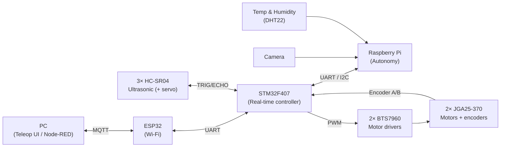
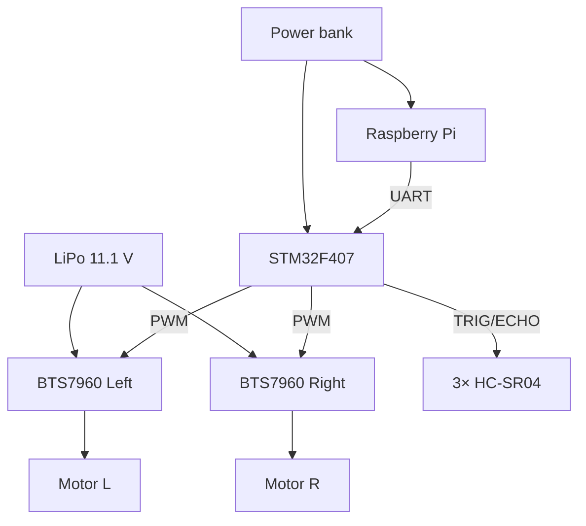
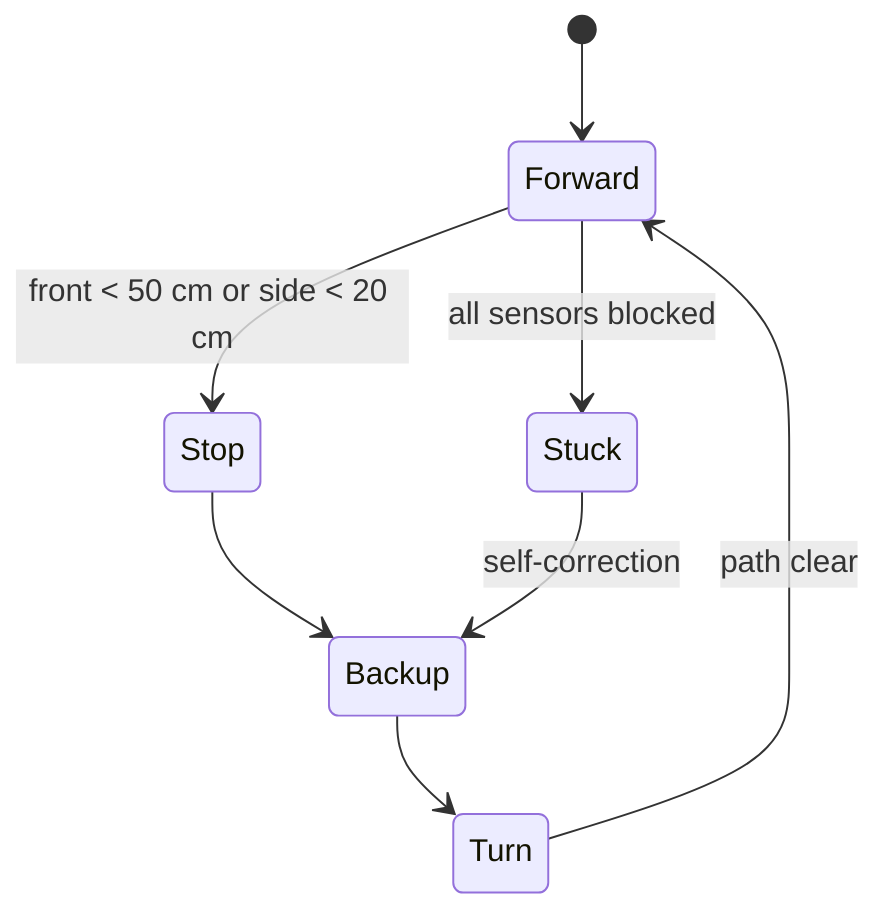

# 🤖 Optimus — Smart Autonomous Vehicle (EmbodiedAI)

> **TRSYP 2.0 Technical Challenge** · IEEE ENIT Student Branch — RAS & Sensors Council Joint Chapter
> Team **OPTIMUS**

Optimus is a **hybrid mobile robot** that runs in both **autonomous** and **manual (teleoperated)** modes. It splits the work between a real-time microcontroller and an embedded Linux computer:

- **STM32F407** handles hard real-time work under **FreeRTOS**: motor PWM, encoders, ultrasonic ranging, safety and telemetry.
- **Raspberry Pi** handles high-level autonomy: camera-based perception, AI risk prediction, data logging and MQTT networking.
- **ESP32** provides the Wi-Fi/MQTT link to a PC-side **Node-RED** dashboard for monitoring and remote control.

---

## Table of Contents

- [Features](#features)
- [System Architecture](#system-architecture)
- [Hardware](#hardware)
- [Wiring & Power](#wiring--power)
- [Software Architecture](#software-architecture)
- [Control Model](#control-model)
- [Navigation Algorithm](#navigation-algorithm)
- [Communication (MQTT & Node-RED)](#communication-mqtt--node-red)
- [Repository Structure](#repository-structure)
- [Getting Started](#getting-started)
- [Requirements Traceability](#requirements-traceability)
- [Roadmap](#roadmap)
- [Team](#team)
- [License](#license)

---

## Features

- 🚗 **Differential drive** with two encoder DC motors and a ball caster
- ⏱️ **FreeRTOS** task separation on the STM32: motion, encoders, sensors, communication, safety, telemetry
- 🎯 **PID speed regulation** using wheel encoder feedback
- 📡 **3× ultrasonic sensors** (front / left / right) for reactive obstacle avoidance
- 🧠 **AI risk prediction** on the Raspberry Pi (OpenCV + TensorFlow Lite / MobileNet)
- 🌡️ **Environmental logging** (temperature & humidity)
- 🔁 **Stuck detection & self-correction** (back up + turn)
- 📊 **MQTT telemetry** via a Mosquitto broker and a **Node-RED** dashboard
- 🛑 **Emergency stop** and fault protection

---

## System Architecture



| Module | Platform | Responsibility |
|---|---|---|
| Real-Time Control | STM32F407 | Actuation, encoders, ranging, safety, telemetry |
| Autonomous Intelligence | Raspberry Pi | Perception, AI risk prediction, decision-making, logging |
| Communication & Telemetry | ESP32 + Mosquitto + Node-RED | Wi-Fi link, MQTT routing, dashboard |
| Power Management | LiPo + power bank | Motor power and logic power on separate supplies |

| Interface | Used for |
|---|---|
| **MQTT** | Networked, real-time telemetry and commands between subsystems |
| **UART** | Reliable serial link for commands and data (STM32 ↔ Pi, STM32 ↔ ESP32) |
| **I²C** | Short-range MCU ↔ sensor communication |
| **PWM** | Motor speed/direction via duty cycle |

---

## Hardware

| Qty | Component | Role |
|---|---|---|
| 1 | STM32F407G-DISC1 (STM32F407VGT6) | Real-time controller, FreeRTOS |
| 1 | Raspberry Pi + Camera module + ribbon cable | Autonomy, AI, MQTT, logging |
| 1 | ESP32 DevKit | Wi-Fi / MQTT bridge |
| 2 | JGA25-370 DC gear motors with encoders | Differential drive |
| 2 | BTS7960 H-bridge driver modules | Motor power stage |
| 3 | HC-SR04 ultrasonic sensors | Front / left / right ranging |
| 1 | Ball caster | Third contact point |
| 1 | DHT22 | Temperature & humidity |
| 1 | LiPo battery, 11.1 V | Motor power |
| 1 | USB power bank | Logic power (Pi, STM32) |
| — | Aluminium profile frame + plates | Chassis (designed in SolidWorks) |

The mechanical design was modelled and assembled in **SolidWorks** before construction to plan weight distribution, sensor layout, motor positioning and wiring paths. CAD files live in [`hardware/cad/`](hardware/cad/).

---

## Wiring & Power



Notes:

- **Motor and logic supplies are separate** to keep motor noise and current spikes away from the Pi and MCU. **All grounds must be common.**
- Each BTS7960 is driven with `RPWM` / `LPWM` (direction + duty) and `R_EN` / `L_EN` (enable).
- HC-SR04 `ECHO` outputs 5 V: connect to **5 V-tolerant (FT)** STM32 pins or use a voltage divider.
- Pin assignments are documented in [`docs/pinout.md`](docs/pinout.md).

---

## Software Architecture

### STM32F407 — Real-Time Control (FreeRTOS)

| Task | Description |
|---|---|
| `MotorTask` | PID speed loop, PWM output to BTS7960 drivers |
| `EncoderTask` | Reads quadrature encoders (timer encoder mode), computes wheel speed |
| `SensorTask` | Triggers HC-SR04 sensors, measures echo time (input capture) |
| `CommTask` | UART with DMA to Raspberry Pi and ESP32; command parsing |
| `SafetyTask` | Emergency stop (ISR-triggered), fault protection, watchdog |
| `TelemetryTask` | Packs and sends state (speeds, distances, mode, faults) |

### Raspberry Pi — Autonomous Intelligence

- Python services for perception and decision-making
- **OpenCV** camera pipeline for visual navigation
- **TensorFlow Lite (MobileNet)** inference on captured frames to estimate collision risk
- DHT22 environmental logging
- Sensor diagnostics (data integrity, sensor failure detection)
- Emergency behaviours: stop, reroute, alert
- MQTT client (publishes telemetry, subscribes to commands)

### ESP32 — Communication Bridge

- Connects to Wi-Fi and the Mosquitto broker
- Bridges MQTT messages ↔ STM32 over UART for teleoperation

---

## Control Model

**Differential drive:**

| Motion | Left wheel | Right wheel |
|---|---|---|
| Forward | `vL = v` | `vR = v` |
| Turn left | `vL = −v` | `vR = +v` |
| Turn right | `vL = +v` | `vR = −v` |

**Adaptive speed:**

```
speed = speed_min + d₁ × (speed_max − speed_min) / 100
```

with `speed_min = 180` and `speed_max = 250` (PWM units), where `d₁` is the front distance reading normalised to 0–100.

---

## Navigation Algorithm

| Parameter | Value |
|---|---|
| Sensors | 3 ultrasonic (front, left, right) |
| Front threshold | **50 cm** |
| Side threshold | **20 cm** |
| PWM range | 180–250 |

**Behaviour:** `Stop → Back up → Turn → Go`



**Stuck detection:** if all three sensors detect an obstacle, the robot backs up and turns to recover.

---

## Communication (MQTT & Node-RED)

- **Mosquitto** routes messages between the robot, the dashboard and control clients.
- **Node-RED** subscribes to telemetry (gauges, charts, logs) and publishes commands (start, stop, emergency, mode).
- MQTT access is secured with **username/password**.
- Data can be exported to **CSV** or **InfluxDB** for post-analysis.

Example topic layout (adapt to the actual implementation):

| Topic | Direction | Payload |
|---|---|---|
| `optimus/telemetry/motors` | robot → dashboard | wheel speeds, PWM |
| `optimus/telemetry/ultrasonic` | robot → dashboard | front / left / right distances (cm) |
| `optimus/telemetry/env` | robot → dashboard | temperature, humidity |
| `optimus/telemetry/ai` | robot → dashboard | collision-risk score, diagnostics |
| `optimus/cmd/mode` | dashboard → robot | `auto` / `manual` |
| `optimus/cmd/drive` | dashboard → robot | teleop velocity command |
| `optimus/cmd/estop` | dashboard → robot | emergency stop |

---

## Repository Structure

```
optimus/
├── firmware/
│   ├── stm32/            # STM32CubeIDE project (FreeRTOS, HAL)
│   └── esp32/            # Wi-Fi / MQTT bridge
├── rpi/
│   ├── perception/       # OpenCV pipeline
│   ├── ai/               # TFLite model + inference
│   ├── logging/          # DHT22 + data logging
│   └── mqtt_client.py
├── dashboard/
│   └── node-red/         # Exported Node-RED flows (flows.json)
├── hardware/
│   ├── cad/              # SolidWorks parts & assembly
│   └── schematics/
├── docs/
│   ├── cahier-des-charges.pdf
│   ├── presentation.pdf
│   └── pinout.md
└── README.md
```

---

## Getting Started

### Prerequisites

- STM32CubeIDE (or STM32CubeMX + ARM GCC)
- Arduino IDE or PlatformIO (ESP32)
- Raspberry Pi OS (64-bit) with Python 3
- Mosquitto broker and Node-RED

### 1. Flash the STM32

1. Open `firmware/stm32/` in STM32CubeIDE.
2. Build and flash to the STM32F407G-DISC1 over ST-LINK.

### 2. Flash the ESP32

1. Set Wi-Fi SSID/password and broker credentials in the configuration file.
2. Build and upload from `firmware/esp32/`.

### 3. Set up the Raspberry Pi

```bash
sudo apt update
sudo apt install -y mosquitto mosquitto-clients python3-opencv
pip install paho-mqtt tflite-runtime
```

Create an MQTT user:

```bash
sudo mosquitto_passwd -c /etc/mosquitto/passwd optimus
```

Run the autonomy stack:

```bash
cd rpi
python3 main.py
```

### 4. Launch the dashboard

```bash
node-red
```

Import `dashboard/node-red/flows.json` and open `http://<host>:1880/ui`.

### 5. Test & calibrate

1. Verify motor direction and encoder counts with the wheels lifted.
2. Tune PID gains for each wheel.
3. Calibrate ultrasonic readings against known distances.
4. Test obstacle avoidance and the emergency stop before free running.

---

## Requirements Traceability

Mapping to the *Cahier des Charges* (23 Oct 2025). Status reflects the prototype as presented; update as the project evolves.

| ID | Requirement | Status | Notes |
|---|---|---|---|
| FRR1 | PWM motor control | ✅ | Implemented as 2WD differential drive (spec: 4WD) |
| FRR2 | Ultrasonic + IMU detection | 🟡 | Ultrasonic done; IMU (MPU9250) optional, not yet integrated |
| FRR3 | FreeRTOS task separation | ✅ | Motion, encoder, sensors, comms, safety, telemetry |
| FRR4 | Battery monitoring | ⬜ | Planned |
| FRR5 | UART bridge to Pi and ESP32 | ✅ | |
| FRR6 | GPIO emergency stop | 🟡 | Safety task / fault protection |
| FRA1 | Camera visual navigation (OpenCV) | 🟡 | |
| FRA2 | DHT22 logging | 🟡 | |
| FRA3 | AI risk prediction (TFLite MobileNet) | 🟡 | |
| FRA4 | Sensor diagnostics | 🟡 | |
| FRA5 | Emergency behaviours (stop / reroute / alert) | 🟡 | |
| FRA6 | MQTT telemetry & commands | ✅ | Mosquitto broker |
| FRA7 | Node-RED dashboard | ✅ | |

✅ done · 🟡 partial / in progress · ⬜ planned

**Design deviations from the specification:**

| Item | Specification | Prototype |
|---|---|---|
| Drivetrain | 4WD, 4 motors | 2WD differential + ball caster |
| Motor drivers | Dual L298N | 2× BTS7960 (higher current, lower losses) |
| Battery | 4S Li-ion with BMS | 11.1 V LiPo (motors) + power bank (logic) |

**Constraints:** flat indoor terrain (thresholds < 1.5 cm), max footprint 600 × 600 mm.

---

## Roadmap

- [ ] Integrate MPU9250 IMU for odometry fusion
- [ ] Battery voltage monitoring and low-battery alerts
- [ ] Servo-mounted scanning ultrasonic sensor
- [ ] OLED/LCD status display
- [ ] Improve AI navigation and path planning
- [ ] Log telemetry to InfluxDB

---

## Team

**Team OPTIMUS** — IEEE RAS SEN ENIT SBJC

| Member |
|---|
| Wajdi Dridi — Chair, IEEE RAS SEN Student Branch Joint Chapter |
| Rebeh Mezrigui |
| Wassim Toukebri |
| Souha Khalfaoui |

## Acknowledgements

TRSYP 2.0 organisers and the IEEE ENIT Student Branch — Robotics & Automation Society and Sensors Council Joint Chapter.

## License

Specify a license (e.g. MIT) in [`LICENSE`](LICENSE).
